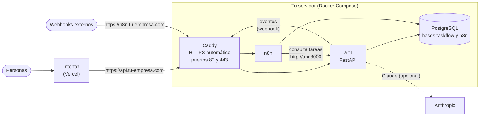

# Despliegue en producción

Guía para publicar la API y n8n de TaskFlow AI en **un servidor propio** con Docker Compose. La
interfaz sigue en Vercel (ver «Despliegue en Vercel» en el README principal).

## Qué se despliega



| Servicio | Imagen | Para qué |
|---|---|---|
| `caddy` | `caddy:2-alpine` | Única entrada desde internet (puertos 80 y 443). Pide y renueva los certificados HTTPS solo |
| `api` | `backend/Dockerfile` | La API. Arranca en modo producción: **no arranca con una configuración de pruebas** |
| `postgres` | `postgres:16-alpine` | Dos bases de datos: `taskflow` y `n8n`. **No tiene puertos publicados** |
| `n8n` | `n8nio/n8n:2.42.7` | Las automatizaciones, con su base de datos y su clave de cifrado |

Qué queda protegido por diseño:

- Solo Caddy publica puertos. La base de datos y la API **no son alcanzables desde internet**.
- La red de la base de datos no tiene salida a internet.
- Los secretos no están en ningún archivo del repositorio: salen de `.env`, y `docker compose` **se
  niega a arrancar** si falta alguno.
- La API corre sin privilegios, con el sistema de archivos en solo lectura y sin capacidades extra.
- Los registros rotan (10 MB × 5 archivos por servicio) para no llenar el disco.

## Requisitos

| Qué | Detalle |
|---|---|
| Servidor Linux | Con [Docker Engine y Docker Compose v2](https://docs.docker.com/engine/install/). Orientativo: 2 GB de RAM y 20 GB de disco (estimación, no medida) |
| Dominio | Con **dos registros DNS de tipo A** hacia la IP del servidor: `api.<dominio>` y `n8n.<dominio>` |
| Puertos | 80 y 443 (TCP) y 443 (UDP) abiertos desde internet; el 22 para ti |
| Correo | Una dirección válida, para los avisos de caducidad de certificados |
| En tu ordenador | Python 3, para generar el hash de la contraseña (`tools/hash_password.py`) |

## Puesta en marcha

### 1. Preparar el servidor

```bash
# Cortafuegos: solo SSH y web
sudo ufw allow 22/tcp && sudo ufw allow 80/tcp && sudo ufw allow 443/tcp && sudo ufw allow 443/udp
sudo ufw enable

git clone https://github.com/itsnirvana-svg/Task_Flow-AI.git /opt/taskflow
cd /opt/taskflow/deploy
```

### 2. Crear el `.env`

```bash
cp .env.example .env
chmod 600 .env
```

Rellena **todos** los valores. Los marcadores `cambia-esto` son inválidos a propósito: la API no
arranca hasta que los sustituyas. Para cada secreto:

```bash
python3 -c "import secrets; print(secrets.token_urlsafe(32))"
```

El hash de la contraseña de la persona administradora se genera **en tu ordenador**, no en el servidor:

```bash
python tools/hash_password.py     # pide la contraseña sin mostrarla
```

Pega el resultado en `ADMIN_PASSWORD_HASH` **entre comillas simples** (contiene `$`).

> **Guarda una copia de `.env` fuera del servidor** (un gestor de contraseñas). Sin `N8N_ENCRYPTION_KEY`
> no se pueden descifrar las credenciales guardadas en n8n, ni siquiera con una copia de la base de datos.

### 3. Arrancar

```bash
docker compose up -d --build
docker compose ps            # api, postgres y n8n deben aparecer como "healthy"
```

La primera vez, PostgreSQL crea las dos bases de datos y aplica `backend/db/schema.sql`. Caddy pide los
certificados en la primera visita (puede tardar un minuto). Comprueba:

```bash
curl https://api.tu-empresa.com/health/ready     # {"status":"ok"}
```

Si no responde, mira «Solución de problemas» al final.

### 4. Crear la cuenta de n8n — **de inmediato**

Abre `https://n8n.tu-empresa.com` y crea la cuenta de propietario **ahora mismo**: la primera persona
que entra se convierte en la dueña de la instalación. Si prefieres no dejar el editor abierto a todo
internet, limita su acceso por IP con el bloque de ENDURECIMIENTO que viene comentado en
[`Caddyfile`](Caddyfile) (los webhooks siguen siendo públicos).

### 5. Importar y proteger el flujo de n8n

Sigue [`../n8n/README.md`](../n8n/README.md). Dos diferencias en este despliegue:

- En el nodo **Consultar la tarea en la API**, usa `http://api:8000/api/tasks/{{ $json.task_id }}`
  (n8n y la API comparten red de Docker; no hace falta pasar por internet).
- Los valores de las credenciales son los de tu `.env`: `N8N_WEBHOOK_SECRET` para el secreto del
  webhook, y la clave de `API_KEYS` para `n8n`.

Verifícalo: `python tools/check_n8n.py https://n8n.tu-empresa.com/webhook/taskflow` debe terminar en
«Todo correcto».

### 6. Conectar la interfaz (Vercel)

1. En Vercel: variable `TASKFLOW_API_URL` = `https://api.tu-empresa.com` (solo el origen).
2. En [`../vercel.json`](../vercel.json): añade esa dirección a `connect-src` de la política CSP.
3. En `.env`: `CORS_ORIGINS` = la dirección de la interfaz, y aplica el cambio con
   `docker compose up -d api`.
4. Vuelve a desplegar la interfaz, entra con tu usuario y crea una tarea: debería quedar un evento
   procesado en el historial de ejecuciones de n8n.

## Copias de seguridad

Las bases de datos (`taskflow` y `n8n`) se copian con [`backup.sh`](backup.sh):

```bash
./backup.sh                              # copia en ./backups y borra las de más de 14 días
BACKUP_DIR=/mnt/copias BACKUP_DAYS=30 ./backup.sh
```

Prográmala cada noche (`crontab -e`):

```text
0 3 * * * /opt/taskflow/deploy/backup.sh >> /var/log/taskflow-backup.log 2>&1
```

Cada copia se escribe primero en un archivo temporal, se comprueba que es un volcado válido y solo
entonces recibe su nombre definitivo: no queda ninguna copia a medias con aspecto de buena.

### Lo que falta por tu parte: copiarlas fuera del servidor

**Las copias quedan en el mismo servidor.** Si el servidor se pierde, se pierden con ellas. Añade a la
programación una copia a otro sitio (otro servidor, almacenamiento de objetos…), por ejemplo con
`rclone` o `scp`:

```text
30 3 * * * rclone copy /opt/taskflow/deploy/backups remoto:taskflow-copias --max-age 2d
```

Y guarda aparte el archivo `.env`.

### Restaurar

```bash
./restore.sh taskflow backups/taskflow-20261021T030000Z.sql.gz
./restore.sh n8n      backups/n8n-20261021T030000Z.sql.gz
```

El script detiene el servicio que usa esa base de datos, pide confirmar escribiendo su nombre,
**sustituye** los datos actuales y vuelve a arrancar el servicio.

> **Prueba la restauración antes de necesitarla**, por ejemplo una vez al mes en un servidor de
> prueba. Una copia que nunca se ha restaurado no es una copia.

## Operación diaria

| Quiero… | Comando |
|---|---|
| Ver el estado | `docker compose ps` |
| Ver los registros | `docker compose logs -f api` (o `n8n`, `caddy`, `postgres`) |
| Actualizar la aplicación | `git pull && docker compose up -d --build` |
| Actualizar n8n | Cambia la versión de la imagen en `docker-compose.yml`, haz una copia y `docker compose up -d` |
| Reiniciar la API | `docker compose restart api` |
| Ver eventos que no llegaron a n8n | `docker compose exec postgres psql -U taskflow -d taskflow -c "select status, count(*) from event_outbox group by 1"` (los `dead` agotaron sus reintentos) |
| Detener todo (sin borrar datos) | `docker compose down` — **no** uses `down -v`: borra los volúmenes |

### Cambios en la base de datos

Una instalación nueva ya incluye todo el esquema. Si actualizas una existente y la versión nueva trae
una migración (archivos de `backend/db/migrations/`), aplícala una vez, **después de hacer una copia**:

```bash
docker compose exec -T postgres psql -U taskflow -d taskflow -v ON_ERROR_STOP=1 \
    < ../backend/db/migrations/nombre-de-la-migracion.sql
```

Las migraciones son idempotentes: ejecutarlas dos veces no rompe nada.

### Volver a una versión anterior

```bash
git checkout v0.2.0 && docker compose up -d --build
```

Si la versión nueva ya había cambiado la base de datos, restaura antes la copia de seguridad anterior.

### Vigilancia

Configura un servicio externo de comprobación (UptimeRobot, Better Stack, el que prefieras) sobre:

- `https://api.tu-empresa.com/health/ready` — la API responde **y** la base de datos también;
- `https://n8n.tu-empresa.com/healthz` — n8n responde.

Revisa también el espacio en disco (`df -h`, `docker system df`).

## Lista de seguridad antes de abrir al público

- [ ] `.env` con permisos `600`, fuera de Git, y con una copia en un gestor de contraseñas.
- [ ] Todos los secretos generados al azar (no los marcadores `cambia-esto`).
- [ ] Cuenta de propietario de n8n creada; editor limitado por IP si es posible.
- [ ] Flujo de n8n importado, **flujo del curso (`nueva-tarea`) desactivado** y `check_n8n.py` en verde.
- [ ] Cortafuegos con solo los puertos 22, 80 y 443.
- [ ] Copia de seguridad programada **y copiada fuera del servidor**, con una restauración probada.
- [ ] Vigilancia externa configurada.
- [ ] `CORS_ORIGINS` con solo la dirección de la interfaz.

## Límites conocidos

- **Un solo servidor:** si cae, el servicio se interrumpe hasta restaurarlo. No hay alta disponibilidad.
- **Las copias locales no protegen de perder el servidor** hasta que las copies fuera.
- **Los límites de uso** (inicio de sesión e IA) se cuentan en memoria y por proceso; por eso la API
  corre con un solo proceso. Con varios, el límite real sería el configurado por el número de procesos.
- **Las migraciones son manuales** (aún no hay una herramienta como Alembic).
- **No hay métricas ni registros centralizados**: solo los registros de Docker.
- **El editor de n8n está abierto por defecto** (lo normal en n8n): limítalo por IP (ver paso 4).
- Esta guía y sus archivos se validan en el CI (`docker compose config`, imagen, arranque de PostgreSQL
  y API, y un ciclo de copia y restauración), pero **no se han probado en un servidor real**.

## Alternativa: servicios gestionados

Si prefieres no administrar un servidor, la API cabe en un servicio de contenedores (Render, Railway,
Fly.io…) con una base PostgreSQL gestionada. Qué cambiar:

- Usa `backend/Dockerfile` y define las mismas variables de entorno de `deploy/.env.example`.
- `DATABASE_URL` apunta a la base gestionada; aplica `backend/db/schema.sql` una vez.
- Mantén **un solo proceso** de la API (los límites de uso son por proceso).
- n8n: su servicio gestionado, o un contenedor aparte con su propia base de datos.
- Las copias y la restauración pasan a ser las del proveedor: comprueba su política de retención.

## Solución de problemas

| Síntoma | Causa y solución |
|---|---|
| `docker compose up` dice «required variable … is missing» | Falta un valor en `.env`: el mensaje dice cuál |
| La API se reinicia en bucle | `docker compose logs api`: arranca con «Configuración no válida para producción» y **lista qué corregir** (claves cortas, hash mal formado, dirección de n8n…) |
| Caddy no obtiene certificado | El DNS aún no apunta al servidor, o los puertos 80/443 están cerrados. Comprueba con `dig api.tu-empresa.com` y `docker compose logs caddy` |
| `https://n8n…/webhook/taskflow` da 404 | El flujo no está activo (publicado) en n8n, o la ruta del webhook no es `taskflow` |
| Los eventos quedan `pending` | n8n no responde 2xx: mira `docker compose logs n8n` y el historial de ejecuciones; la API reintenta sola con espera creciente |
| Falla el inicio de sesión desde la interfaz | `CORS_ORIGINS` no coincide exactamente con la dirección de la interfaz, o falta la API en `connect-src` de `vercel.json` |
