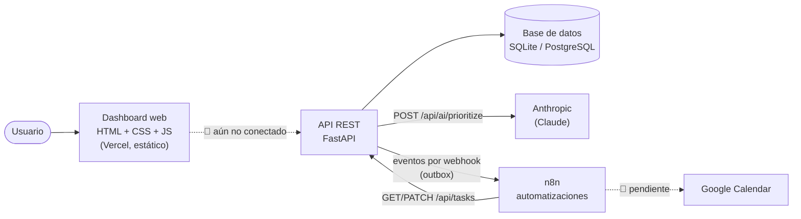
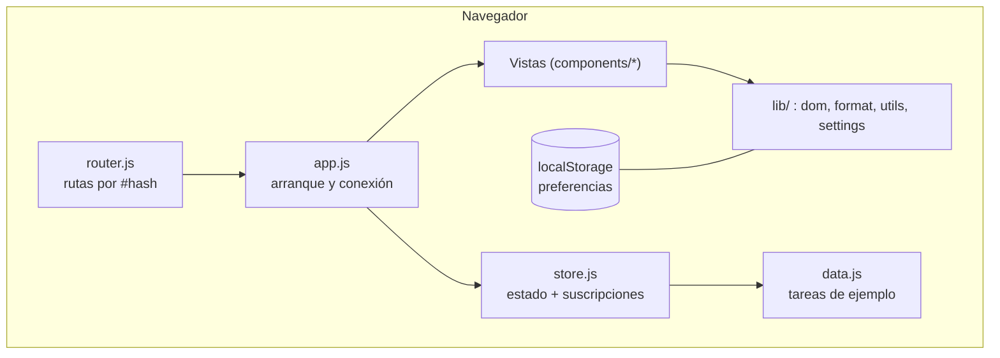
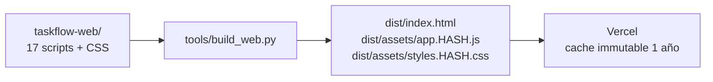
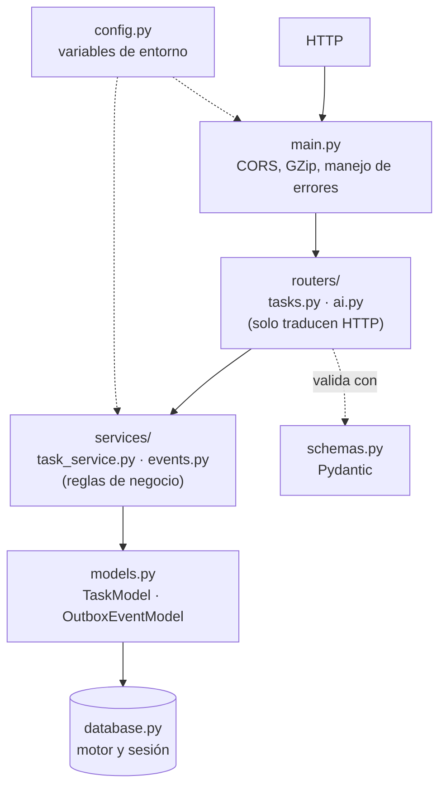
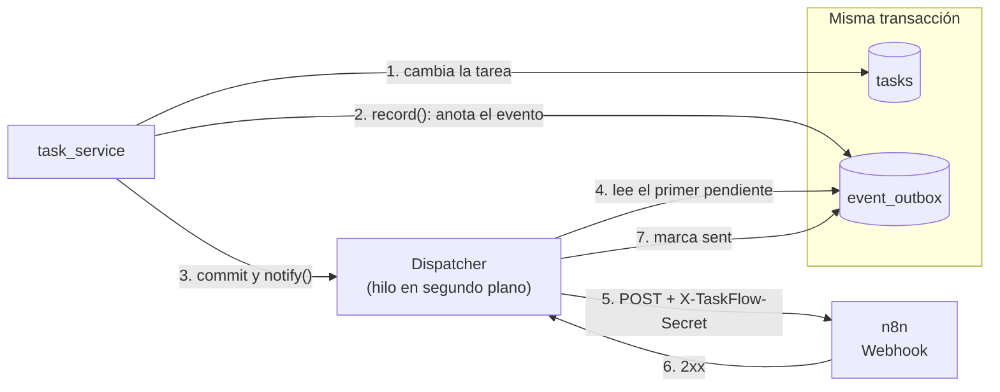
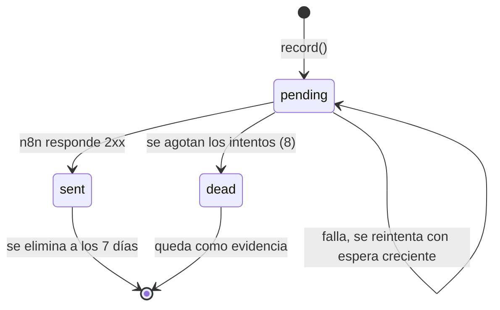
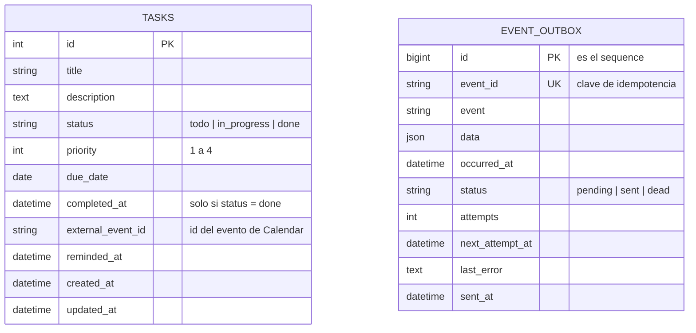
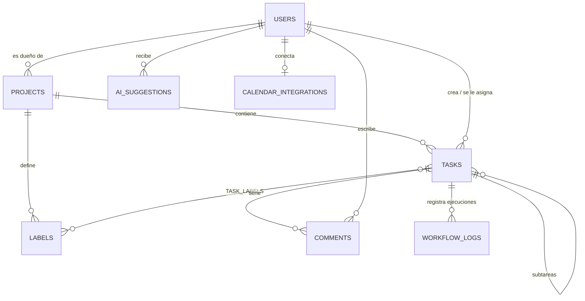
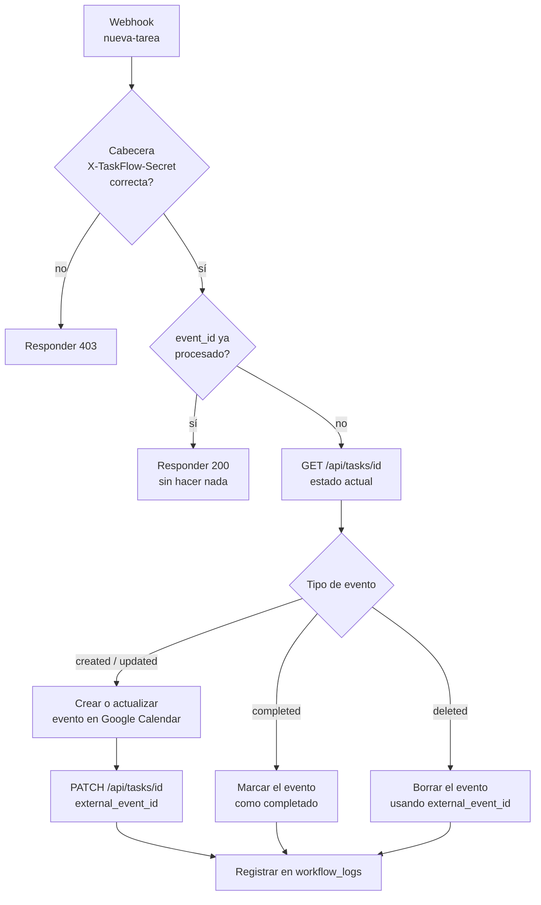

# Arquitectura de TaskFlow AI

Este documento describe cómo está construido TaskFlow AI (versión 0.2.0): qué piezas tiene, cómo se
comunican y qué parte del diseño ya está implementada. Los diagramas usan
[Mermaid](https://mermaid.js.org/), que GitHub dibuja directamente.

**Leyenda de estado:** ✅ implementado · 🟡 implementado a medias · 🔴 diseñado, sin implementar.

## Índice

1. [Visión general](#1-visión-general)
2. [Frontend](#2-frontend)
3. [Backend](#3-backend)
4. [Integración con n8n](#4-integración-con-n8n)
5. [Base de datos](#5-base-de-datos)
6. [APIs externas](#6-apis-externas)
7. [Flujo de automatización](#7-flujo-de-automatización)
8. [Componentes principales](#8-componentes-principales)
9. [Decisiones de diseño](#9-decisiones-de-diseño)
10. [Límites actuales y siguientes pasos](#10-límites-actuales-y-siguientes-pasos)

---

## 1. Visión general

TaskFlow AI se compone de cuatro piezas que se despliegan por separado.



| Pieza | Dónde se ejecuta | Estado |
|---|---|---|
| Dashboard web | Vercel (sitio estático) | 🟡 Funciona con datos de ejemplo |
| API REST | Proceso Python de larga duración | ✅ |
| Base de datos | SQLite (desarrollo) / PostgreSQL (producción) | ✅ |
| n8n | Proceso propio (hoy, en el equipo local) | 🟡 Recibe eventos; flujo completo pendiente |

La API y n8n **no** pueden alojarse en Vercel: el despachador de eventos es un hilo en segundo plano y
n8n es un proceso permanente, y las funciones de Vercel se congelan al responder.

---

## 2. Frontend

Carpeta: `taskflow-web/`. HTML5, CSS3 y JavaScript **sin dependencias ni compilador**.

### 2.1 Capas



- **Un único objeto global**, `window.TaskFlow`, evita variables sueltas. Los scripts son clásicos
  (no módulos ES), por lo que funcionan también abriendo `index.html` desde el disco.
- **Estado** (`store.js`): la lista de tareas, el filtro y la búsqueda viven en memoria. Los componentes
  se **suscriben** y se redibujan cuando cambia algo (patrón observador).
- **Navegación** (`router.js`): rutas por `#/tareas`, `#/proyectos?proyecto=…`. No necesita reglas de
  reescritura del servidor y mantiene atrás/adelante y enlaces directos.
- **Preferencias** (nombre, tema, calendario) se guardan en `localStorage`; las tareas, de momento, no.

### 2.2 Vistas

| Vista | Ruta | Componente |
|---|---|---|
| Dashboard | `#/dashboard` | `stat-cards.js`, `task-table.js` |
| Tareas | `#/tareas` | `task-list.js` |
| Proyectos | `#/proyectos` | `projects-view.js` |
| Calendario | `#/calendario` | `calendar-view.js` |
| Configuración | `#/configuracion` | `settings-view.js` |

Componentes compartidos: `badge.js` (insignias), `task-dialog.js` (diálogo «Nueva tarea»),
`sidebar.js` (menú lateral y menú móvil).

### 2.3 Seguridad de la interfaz

- El DOM se construye con la función `h()` y `textContent`: **nunca `innerHTML`** (evita XSS).
- Sin estilos ni manejadores en línea, para cumplir la **CSP** (`script-src 'self'`,
  `style-src 'self'`, `frame-ancestors 'none'`). Una prueba automática lo vigila.
- Sin recursos de otros dominios.

### 2.4 Empaquetado



Une y minifica (rjsmin/rcssmin; si no están, construye sin minificar) y añade un resumen del contenido
al nombre del archivo: **de 19 peticiones a 3**, y el navegador solo vuelve a descargar lo que cambia.

---

## 3. Backend

Carpeta: `backend/app/`. FastAPI + SQLAlchemy 2, en tres capas con responsabilidades separadas.



### 3.1 Endpoints

| Método | Ruta | Descripción |
|---|---|---|
| `GET` | `/health` | Comprobación de vida |
| `GET` | `/api/tasks` | Lista con filtro por estado y paginación |
| `GET` | `/api/tasks/{id}` | Detalle |
| `POST` | `/api/tasks` | Crear (201) |
| `PATCH` | `/api/tasks/{id}` | Editar parcialmente |
| `DELETE` | `/api/tasks/{id}` | Eliminar (204) |
| `POST` | `/api/ai/prioritize` | Pide a Claude un orden de prioridad |

### 3.2 Reglas de negocio (`task_service.py`)

- Una tarea está `done` **si y solo si** tiene `completed_at` (también lo exige una restricción en la
  base de datos).
- Un `PATCH` que **no cambia nada** no guarda ni emite eventos.
- Completar una tarea emite solo `task.completed`; el resto de cambios, `task.updated`.
- Los campos que escriben las automatizaciones (`external_event_id`, `reminded_at`) **no generan
  eventos**: evitan que n8n se dispare a sí mismo.
- Los errores de «no existe» se convierten en un `404` en un único punto (`main.py`).

### 3.3 Configuración por entorno (`config.py`)

`APP_ENV` elige el perfil. En `production` la aplicación **no arranca** si hay SQLite, `localhost`,
rutas `/webhook-test/`, direcciones sin `https` o falta el secreto del webhook; el error indica qué
corregir. Así no se despliega por accidente apuntando a un entorno de pruebas.

### 3.4 Ciclo de vida

Al arrancar, `main.py` crea las tablas (solo desarrollo) y lanza el **despachador de eventos**. Al
apagarse lo detiene y los eventos sin enviar **quedan en la base de datos** hasta el siguiente arranque.

---

## 4. Integración con n8n

La API **no llama a n8n dentro de la petición del usuario**. Usa el patrón **outbox transaccional**:
el evento se guarda junto con el cambio y otro hilo lo entrega después.

### 4.1 Por qué un outbox

Enviar el webhook directamente tendría dos fallos posibles: que la tarea se guarde y el aviso se
pierda (n8n caído), o que el aviso salga y la tarea no se confirme. El outbox hace que **o ocurren las
dos cosas o ninguna**, y que una caída de n8n no afecte a quien usa la API.

### 4.2 Componentes



### 4.3 Estados de un evento



| Parámetro | Valor por defecto | Variable |
|---|---|---|
| Intentos máximos | 8 | `EVENTS_MAX_ATTEMPTS` |
| Espera inicial / máxima | 5 s / 15 min (se duplica en cada intento) | `EVENTS_RETRY_BASE_SECONDS`, `EVENTS_RETRY_MAX_SECONDS` |
| Sondeo del despachador | 1 s (se despierta antes con `notify()`) | `EVENTS_POLL_SECONDS` |
| Retención de enviados | 7 días | `EVENTS_RETENTION_DAYS` |
| Tiempo máximo por envío | 5 s | — |

### 4.4 Contrato del mensaje

```json
{
  "event": "task.created",
  "event_id": "uuid",
  "sequence": 42,
  "occurred_at": "2026-10-14T17:42:02+00:00",
  "data": { "task_id": 12 }
}
```

Cabecera de autenticación: `X-TaskFlow-Secret`.

| Evento | Cuándo | `data` |
|---|---|---|
| `task.created` | Al crear | `task_id` |
| `task.updated` | Cambian otros datos | `task_id`, `changed` (lista de campos) |
| `task.completed` | Pasa a `done` | `task_id` |
| `task.deleted` | Al eliminar | `task_id`, `external_event_id` |

### 4.5 Garantías y obligaciones del receptor

- Entrega **al menos una vez** y **en orden**: si un evento falla, los siguientes esperan.
- Tras un fallo parcial (n8n lo recibió pero tardó más de 5 s) puede llegar **dos veces con el mismo
  `event_id`**. El flujo de n8n debe **descartar los `event_id` ya procesados**.
- El flujo debe **consultar `GET /api/tasks/{id}`** para conocer el estado actual en lugar de fiarse
  solo del evento (puede haber cambiado desde entonces).
- Si la API se cae o se reinicia, no se pierde ningún pendiente.
- Si n8n se cuelga, **las peticiones a la API no se ven afectadas**.

---

## 5. Base de datos

SQLAlchemy 2 con **SQLite** en desarrollo y **PostgreSQL** (`psycopg`) en producción. Una clase
(`UTCDateTime`) hace que ambos devuelvan siempre fechas con zona horaria UTC.

### 5.1 Lo que el código usa hoy ✅



Restricciones en la propia base de datos: valores permitidos de `status` y `priority`, y la regla
`status = 'done'` ⇔ `completed_at` no nulo. Índices: `idx_tasks_status`, `idx_tasks_due_pending`
(parcial, solo tareas no completadas) e `idx_outbox_pending` (parcial, solo pendientes).

### 5.2 Diseño completo (`backend/db/schema.sql`) 🔴

`schema.sql` describe el **modelo objetivo** de PostgreSQL. El código de la aplicación solo usa
`tasks` y `event_outbox`; el resto espera a que existan proyectos y autenticación.



| Tabla | Propósito | En el código |
|---|---|---|
| `users`, `projects`, `labels`, `task_labels`, `comments` | Usuarios, organización y colaboración | 🔴 |
| `ai_suggestions` | Historial de prompts y respuestas de la IA | 🔴 (hoy no se guarda) |
| `workflow_logs` | Registro de ejecuciones de n8n (`success` / `failed`) | 🔴 |
| `calendar_integrations` | Token de actualización **cifrado** de Google Calendar | 🔴 (migración aparte) |
| `tasks`, `event_outbox` | Ver §5.1 | ✅ |

Las **migraciones** para bases ya creadas están en `backend/db/migrations/`
(`add_event_outbox.sql`, `add_calendar_integrations.sql`) y son idempotentes. En desarrollo, las tablas
se crean solas al arrancar; **en producción deben aplicarse migraciones** (aún no hay una herramienta
como Alembic).

---

## 6. APIs externas

| Servicio | Para qué | Cómo se usa | Configuración | Fallo |
|---|---|---|---|---|
| **Anthropic (Claude)** ✅ | Sugerir el orden de las tareas | SDK oficial; `POST /api/ai/prioritize` envía hasta **50** tareas pendientes (título, prioridad, vencimiento) y devuelve texto | `ANTHROPIC_API_KEY`, `ANTHROPIC_MODEL` | Sin clave → **503**; error de red, cuota o clave inválida → **502**; respuesta vacía → **502** |
| **n8n** ✅ | Automatizaciones | Webhook de entrada (eventos) y llamadas de vuelta a la API | `N8N_WEBHOOK_URL`, `N8N_WEBHOOK_SECRET` | Reintentos con outbox (§4) |
| **Google Calendar** 🔴 | Reflejar fechas límite como eventos y recordatorios | Lo haría n8n, no la API | Credenciales en n8n | Pendiente; las columnas `external_event_id` y `reminded_at` ya existen |

El cliente de Anthropic es único y reutilizable (mantiene conexiones abiertas). La prioridad de la IA
es **una sugerencia de texto**: no modifica las tareas.

---

## 7. Flujo de automatización

### 7.1 Camino del evento (implementado ✅)

```mermaid
sequenceDiagram
    actor U as Usuario o cliente
    participant API as API (FastAPI)
    participant BD as Base de datos
    participant D as Despachador
    participant N as n8n

    U->>API: POST /api/tasks
    API->>BD: INSERT tarea + INSERT evento (una transacción)
    API-->>U: 201 Created (no espera a n8n)
    API->>D: notify()
    D->>BD: lee el primer pendiente
    D->>N: POST /webhook/... + X-TaskFlow-Secret
    alt n8n responde 2xx
        N-->>D: 200
        D->>BD: estado = sent
    else falla o tarda más de 5 s
        D->>BD: attempts + 1, next_attempt_at con espera creciente
        Note over D,N: reintenta; tras 8 intentos pasa a dead
    end
```

### 7.2 Flujo objetivo dentro de n8n (🔴 diseño; no está versionado en el repositorio)

Hoy el repositorio incluye solo una página de prueba del webhook (`tools/n8n-test/`). El flujo de
n8n en sí **no está guardado en el repositorio**; esto es lo que debe hacer:



El `PATCH` de `external_event_id` **no genera un evento nuevo** (regla de §3.2), así que el flujo no se
dispara a sí mismo.

> ⚠️ **Pendiente de seguridad:** el nodo Webhook de n8n aún **no exige** la cabecera
> `X-TaskFlow-Secret` (*Authentication → Header Auth*). La API ya la envía, pero n8n no la verifica,
> así que cualquiera que conozca la dirección del webhook puede enviarle datos.

---

## 8. Componentes principales

| Componente | Archivo | Responsabilidad |
|---|---|---|
| Aplicación | `backend/app/main.py` | Crea la app, CORS, compresión, manejo de errores, ciclo de vida |
| Configuración | `backend/app/config.py` | Variables de entorno y validación por perfil |
| Constantes | `backend/app/constants.py` | Estados, límites y tamaños de página |
| Base de datos | `backend/app/database.py` | Motor, sesión y alias `DbSession` |
| Modelos | `backend/app/models.py` | `TaskModel`, `OutboxEventModel`, `UTCDateTime` |
| Esquemas | `backend/app/schemas.py` | Validación de entrada y salida (Pydantic) |
| Rutas de tareas | `backend/app/routers/tasks.py` | CRUD HTTP, sin lógica |
| Rutas de IA | `backend/app/routers/ai.py` | Priorización con Claude |
| Servicio de tareas | `backend/app/services/task_service.py` | Reglas de negocio y registro de eventos |
| Servicio de eventos | `backend/app/services/events.py` | Outbox y `Dispatcher` |
| Esquema SQL | `backend/db/schema.sql` | Modelo completo de PostgreSQL |
| Dashboard | `taskflow-web/` | Interfaz con 5 vistas |
| Empaquetado | `tools/build_web.py` | Une, minifica y versiona los recursos |
| Despliegue web | `vercel.json` | Construcción, cabeceras de seguridad y caché |
| Integración continua | `.github/workflows/ci.yml` | Lint, pruebas, empaquetado y sintaxis SQL |
| Guardas de calidad | `.claude/hooks/` | Revisión automática durante el desarrollo |

---

## 9. Decisiones de diseño

| Decisión | Motivo |
|---|---|
| Outbox transaccional en lugar de llamar a n8n directamente | No perder eventos y no depender de que n8n esté disponible |
| Routers finos y lógica en `services/` | Reutilizar las reglas desde otros puntos de entrada (CLI, automatizaciones) |
| Perfil de producción que falla al arrancar | Impedir despliegues apuntando a entornos de prueba |
| Frontend sin dependencias, scripts clásicos | Funciona desde el disco, sin compilador, y es auditable |
| CSP estricta y `h()` sin `innerHTML` | Reducir la superficie de ataques XSS |
| Hash en el nombre de los recursos + caché `immutable` | Carga rápida; solo se descarga lo que cambió |
| Entrega «al menos una vez» con `event_id` | Más simple y robusta que «exactamente una vez»; la idempotencia la pone el receptor |
| SQLite en desarrollo, PostgreSQL en producción | Arranque sin instalar nada y base robusta al publicar |

---

## 10. Límites actuales y siguientes pasos

| Tema | Situación | Siguiente paso |
|---|---|---|
| Interfaz y API | Desconectadas: el dashboard usa datos de ejemplo | Sustituir los métodos de `store.js` por llamadas a `/api/tasks`; añadir el dominio de la API a `connect-src` en `vercel.json` y `CORS_ORIGINS` en la API |
| Autenticación | Inexistente: cualquiera con acceso a la API puede usarla | Usuarios y sesiones (tablas `users` y `projects` ya diseñadas) |
| Webhook de n8n | Sin verificar la cabecera secreta | Activar *Header Auth* y descartar `event_id` repetidos |
| Flujo de n8n | No versionado | Exportar el flujo a JSON y guardarlo en el repositorio |
| Google Calendar | Sin implementar | Flujo en n8n y tabla `calendar_integrations` |
| Migraciones | Manuales (`psql`) | Adoptar Alembic antes de producción |
| PostgreSQL | El esquema se valida con `pglast`, pero no se ha ejecutado contra un servidor real | Probar con una instancia real (p. ej., en Docker) |
| Escalado del despachador | Un hilo por proceso: con varias réplicas de la API habría varios despachadores | Un solo proceso despachador, o bloqueo de filas (`FOR UPDATE SKIP LOCKED`) |
| Historial de IA y registros de n8n | Tablas diseñadas, no usadas | Guardar cada sugerencia y cada ejecución |
