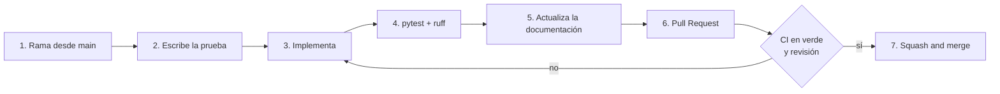

# Guía para colaborar en TaskFlow AI

Gracias por querer ayudar. Esta guía explica cómo preparar el entorno, dónde va cada cosa, qué reglas
sigue el código y cuál es el camino recomendado para añadir una funcionalidad y que se fusione sin
sorpresas.

Para entender cómo encajan las piezas, lee antes [ARQUITECTURA.md](ARQUITECTURA.md). Para usar el
proyecto sin modificarlo, basta el [README](../README.md).

## Índice

1. [Requisitos del proyecto](#1-requisitos-del-proyecto)
2. [Instalación del entorno](#2-instalación-del-entorno)
3. [Organización del código](#3-organización-del-código)
4. [Convenciones utilizadas](#4-convenciones-utilizadas)
5. [Flujo para agregar una funcionalidad](#5-flujo-para-agregar-una-funcionalidad)
6. [Buenas prácticas durante el desarrollo](#6-buenas-prácticas-durante-el-desarrollo)
7. [Lista de comprobación antes de abrir el Pull Request](#7-lista-de-comprobación-antes-de-abrir-el-pull-request)

---

## 1. Requisitos del proyecto

| Requisito | Versión | Para qué |
|---|---|---|
| Python | **3.10 o superior** (el CI usa 3.12) | API, pruebas y empaquetado |
| Git | Reciente | Control de versiones |
| Node.js | 18 o superior | Solo para `node --check` sobre el JavaScript y para n8n (opcional) |
| Cuenta de GitHub | | Para abrir Pull Requests |
| Clave de Anthropic | Opcional | Probar la priorización con IA (`ANTHROPIC_API_KEY`) |
| n8n | Opcional | Probar las automatizaciones (`npm install -g n8n`) |
| PostgreSQL 14+ | Opcional | Solo para probar el perfil de producción |

No se necesita ninguna base de datos instalada para desarrollar: por defecto se usa SQLite.

**Soporte de versiones:** el código debe funcionar en Python 3.10. Por eso se usa
`timezone.utc` y no `datetime.UTC` (que existe desde 3.11).

---

## 2. Instalación del entorno

### 2.1 Obtener el código

Haz un *fork* del repositorio (o clónalo directamente si tienes permisos) y crea tu copia local:

```bash
git clone https://github.com/<tu-usuario>/Task_Flow-AI.git
cd Task_Flow-AI
```

### 2.2 Backend

```bash
cp .env.example .env              # en Windows: copy .env.example .env
cd backend
python -m venv .venv
.venv\Scripts\activate            # en Linux/macOS: source .venv/bin/activate
pip install -r requirements-dev.txt
```

`requirements-dev.txt` incluye las dependencias de producción más `pytest` y `ruff`.

Edita `.env` solo si lo necesitas. Para desarrollar no hace falta tocar nada: SQLite, sin webhook de
n8n y sin clave de IA son los valores por defecto. **Nunca subas `.env`**: está en `.gitignore`.

### 2.3 Arrancar y comprobar que funciona

```bash
# Desde backend/
uvicorn app.main:app --reload     # API en http://localhost:8000 (documentación en /docs)
```

```bash
# Desde la raíz del proyecto
pytest                            # debe terminar en verde
ruff check backend/app backend/tests .claude tools
```

El dashboard se abre con doble clic en `taskflow-web/index.html`. No hay que compilar nada.

### 2.4 Empaquetado de la interfaz (opcional)

```bash
pip install -r tools/requirements.txt
python tools/build_web.py         # genera taskflow-web/dist/
```

### 2.5 n8n (opcional)

Para probar la entrega de eventos, enciende n8n y define en `.env`:

```text
N8N_WEBHOOK_URL=http://localhost:5678/webhook/nueva-tarea
N8N_WEBHOOK_SECRET=un-secreto-de-prueba
```

Con el flujo activo, la ruta debe ser la de producción (`/webhook/...`); la de pruebas
(`/webhook-test/...`) solo atiende una petición.

### 2.6 Problemas frecuentes

| Síntoma | Causa y solución |
|---|---|
| `ModuleNotFoundError: app` al ejecutar `pytest` | Ejecútalo **desde la raíz del proyecto**, donde está `pyproject.toml` |
| La tabla no tiene la columna nueva | `create_all` solo crea tablas que no existen; borra `taskflow.db` o aplica la migración |
| `Configuración no válida para producción` | Tienes `APP_ENV=production` con valores de desarrollo; el mensaje indica cuáles |
| `403` al subir a GitHub | Sesión de otra cuenta: elimina `git:https://github.com` del Administrador de credenciales de Windows |

---

## 3. Organización del código

```text
Task_Flow-AI/
├── backend/
│   ├── app/
│   │   ├── main.py            # crea la aplicación, CORS, compresión y arranque
│   │   ├── config.py          # variables de entorno y validación por perfil
│   │   ├── constants.py       # estados, límites y tamaños de página
│   │   ├── database.py        # motor, sesión y DbSession
│   │   ├── models.py          # tablas (SQLAlchemy)
│   │   ├── schemas.py         # validación de entrada y salida (Pydantic)
│   │   ├── routers/           # capa HTTP: tasks.py, ai.py
│   │   └── services/          # reglas de negocio: task_service.py, events.py
│   ├── db/schema.sql          # esquema completo de PostgreSQL
│   ├── db/migrations/         # cambios para bases ya creadas
│   └── tests/                 # pruebas del backend
├── taskflow-web/              # dashboard (HTML, CSS y JS sin dependencias)
│   └── js/{lib,components}/   # utilidades y componentes
├── tools/                     # build_web.py y pruebas del empaquetado
├── .claude/hooks/             # guardas automáticas de calidad y secretos (ver 6.7)
├── .github/workflows/ci.yml   # integración continua
├── vercel.json                # despliegue de la interfaz
└── pyproject.toml             # configuración común de pytest y ruff
```

### 3.1 La regla de las capas (backend)

```text
HTTP  →  routers/  →  services/  →  models  →  base de datos
```

| Capa | Hace | **No** hace |
|---|---|---|
| `routers/` | Traduce la petición HTTP y la respuesta; declara códigos de estado | Reglas de negocio, consultas, eventos |
| `services/` | Reglas de negocio, transacciones y registro de eventos | Conocer HTTP (`Request`, códigos de estado) |
| `models.py` | Estructura de las tablas | Lógica |
| `schemas.py` | Validar lo que entra y define lo que sale | Acceder a la base de datos |

Si una regla está en el router, no se puede reutilizar desde otra entrada (una futura CLI, una
automatización). Ponla en `services/`.

### 3.2 Dónde va cada cosa

| Quiero… | Lo hago en… |
|---|---|
| Añadir o cambiar un límite o un estado | `constants.py` (única fuente de verdad) |
| Añadir una variable de entorno | `config.py` **y** `.env.example` |
| Añadir un endpoint | `routers/` + `schemas.py` + `services/` |
| Añadir una regla de negocio | `services/task_service.py` |
| Emitir un evento nuevo | `services/task_service.py` (con `events.record`) |
| Cambiar una tabla | `models.py` + `db/schema.sql` + una migración |
| Añadir una vista o un componente | `taskflow-web/js/components/` (ver su README) |
| Cambiar cabeceras de seguridad o caché | `vercel.json` |

---

## 4. Convenciones utilizadas

### 4.1 Idioma

- **Comentarios, docstrings, mensajes de error y documentación:** español.
- **Identificadores** (variables, funciones, clases, campos de la API): inglés en el backend
  (`task_service`, `due_date`); en el frontend, el vocabulario de la interfaz (`pendiente`,
  `en-progreso`) vive solo en `lib/format.js`.

### 4.2 Python

Configuración en `pyproject.toml`; la aplica `ruff`.

| Regla | Valor |
|---|---|
| Longitud de línea | 100 caracteres |
| Versión objetivo | Python 3.10 |
| Reglas activas | `E`, `F`, `W`, `B`, `UP`, `SIM`, `I` (orden de imports), `C4`, `PIE` |
| Tipos | Anotaciones en funciones públicas (`str \| None`, `list[str]`) |
| Fechas | Siempre con zona horaria UTC (`datetime.now(timezone.utc)`); la columna usa `UTCDateTime` |
| Base de datos | Se recibe por `DbSession` en las rutas y como `Session` en los servicios |
| Constantes | En `constants.py`, nunca números ni textos repetidos |

### 4.3 JavaScript (interfaz)

- Scripts **clásicos** (no módulos ES), cada uno dentro de una función que cuelga de
  `window.TaskFlow`. Así la página funciona abriendo `index.html` desde el disco.
- El DOM se crea con `h()` (`lib/dom.js`). **Prohibido** usar HTML dentro de cadenas, ni
  estilos en línea (`.style.x = …`) ni manejadores en línea (`onclick="…"`): la política de
  seguridad (CSP) de `vercel.json` los bloquea y hay una prueba que lo vigila.
- Sin recursos de otros dominios (fuentes, scripts ni imágenes remotas).
- Cada componente exporta `init(contenedor, contexto)` y devuelve `{ update }`.
- Todo el texto de usuario se inserta como texto (`text:`), nunca como HTML.

### 4.4 SQL y migraciones

- `db/schema.sql` describe el esquema **completo** para instalaciones nuevas.
- Cada cambio posterior va en un archivo nuevo de `db/migrations/` y debe ser **idempotente**
  (`IF NOT EXISTS`, `ADD COLUMN IF NOT EXISTS`): se puede ejecutar dos veces sin error.
- El CI comprueba la sintaxis de todos los `.sql`.

### 4.5 Comentarios

Se comenta el **porqué**, no el qué. Un comentario debe aportar algo que el código no dice (una
decisión, un contrato, una trampa). Cada módulo con lógica no evidente lleva un docstring inicial.
Los docstrings de las rutas aparecen en `/docs`: escríbelos pensando en quien consume la API.

### 4.6 Ramas

| Prefijo | Uso | Ejemplo |
|---|---|---|
| `feat/` | Funcionalidad nueva | `feat/etiquetas-de-tareas` |
| `fix/` | Corrección de un error | `fix/fecha-vencida-en-calendario` |
| `docs/` | Solo documentación o comentarios | `docs/guia-de-despliegue` |
| `refactor/` | Reorganizar sin cambiar el comportamiento | `refactor/separar-servicio-ia` |

`main` está protegida: **no se hace commit directo**; todo entra por Pull Request.

### 4.7 Commits

Formato: `tipo: descripción en español, en presente y sin punto final`.

```text
feat: añade el filtro por prioridad en el listado de tareas
fix: corrige el cálculo de tareas vencidas en el último día del mes
docs: documenta la entrega de eventos en el README
refactor: mueve la validación del estado al servicio
test: cubre el reintento del despachador tras un fallo de red
```

- Un commit = un cambio con sentido propio; mejor pequeños que gigantes.
- Si el cuerpo es largo, deja una línea en blanco tras el título y explica **por qué**.

---

## 5. Flujo para agregar una funcionalidad



### 5.1 Pasos generales

1. **Actualiza y ramifica:**
   ```bash
   git switch main && git pull
   git switch -c feat/nombre-de-la-mejora
   ```
2. **Empieza por la prueba** que describe lo que debe ocurrir (ver 6.1). Debe fallar antes de
   implementar.
3. **Implementa** respetando las capas (ver 3.1).
4. **Comprueba en local**, desde la raíz:
   ```bash
   pytest
   ruff check backend/app backend/tests .claude tools
   ```
5. **Actualiza la documentación** que cambie: README, `docs/ARQUITECTURA.md`, `.env.example`.
6. **Sube la rama y abre el Pull Request** hacia `main` (ver sección 7).
7. Cuando el CI esté en verde y la revisión aprobada, se fusiona con **Squash and merge**.

### 5.2 Receta A: añadir un campo a la tarea

1. `models.py`: añade la columna a `TaskModel`.
2. `schemas.py`: añádela a `TaskCreate`, `TaskUpdate` y `TaskRead` con sus límites desde
   `constants.py`.
3. `db/schema.sql`: añade la columna al esquema completo.
4. `db/migrations/add_<campo>.sql`: migración idempotente para bases existentes.
5. `services/task_service.py`: si el campo tiene una regla (un valor por defecto, una relación con
   otro campo), impleméntala aquí.
6. Pruebas en `backend/tests/` (validación, valor por defecto, que el `PATCH` lo cambia).
7. Si cambia el contrato con n8n, actualiza la tabla de eventos del README.

> `create_all` solo crea tablas que no existen: en tu base local de desarrollo, borra
> `taskflow.db` o ejecuta la migración para que aparezca la columna.

### 5.3 Receta B: añadir un endpoint

1. Define los esquemas de entrada y salida en `schemas.py`.
2. Escribe la lógica en `services/` (sin conocer HTTP).
3. Declara la ruta en `routers/` con `response_model`, `status_code` y un **docstring** (sale en
   `/docs`). Si el error esperado es «no existe», lanza `TaskNotFoundError`: ya se traduce a 404.
4. Pruebas en `test_api.py` para el caso correcto y para los errores (404, 422).

### 5.4 Receta C: emitir un evento nuevo hacia n8n

1. Llama a `events.record(db, "tarea.nombre", {...})` **antes del `commit`**, en el servicio que
   hace el cambio, para que ambos se confirmen juntos. Después del `commit`, llama a
   `events.notify()`.
2. Pon solo identificadores en `data` (por ejemplo `task_id`): n8n consulta el estado actual.
3. Añade pruebas en `test_events_outbox.py` (se registra, se envía, no se emite cuando no hay
   cambios).
4. Documenta el evento en la tabla del README y en `docs/ARQUITECTURA.md`.
5. Avisa en el Pull Request de que el flujo de n8n debe tratar el nuevo tipo.

### 5.5 Receta D: añadir una vista a la interfaz

Sigue «Cómo añadir una vista» en [`taskflow-web/README.md`](../taskflow-web/README.md): enlace en
el menú, ruta en `router.js`, componente en `js/components/`, `<script>` en `index.html` (antes de
`app.js`) y registro en `app.js`. La prueba `tools/test_build_web.py` falla si un enlace del menú
no tiene su vista o su ruta.

Para probarla, abre `index.html` en el navegador y recorre el menú; ejecuta también
`python tools/build_web.py` para comprobar que el paquete se genera.

---

## 6. Buenas prácticas durante el desarrollo

### 6.1 Pruebas

- Cada cambio de comportamiento lleva su prueba. Un error corregido lleva la prueba que lo
  habría detectado.
- Las pruebas usan una base SQLite **nueva en un archivo temporal por cada prueba**
  (`conftest.py`), así no dependen unas de otras ni de tu `taskflow.db`.
- Usa los ayudantes existentes (`helpers.crear`, las fixtures `client`, `db`, `engine`) en lugar de
  repetir preparación.
- Las pruebas no deben llamar a servicios reales (Anthropic, n8n): sustitúyelos.
- Ejecuta `pytest` desde la raíz; también cubre los hooks y el empaquetado de la interfaz.

### 6.2 Datos y transacciones

- El cambio de una tarea y su evento del outbox se confirman **en la misma transacción**. No
  envíes webhooks directamente desde una ruta.
- Un `PATCH` que no cambia nada no debe guardar ni emitir eventos.
- Los campos que escriben las automatizaciones (`external_event_id`, `reminded_at`) **no** generan
  eventos: evita bucles con n8n.
- No mezcles horarios: guarda y compara siempre en UTC.

### 6.3 Seguridad

- **Nunca** subas secretos: `.env`, claves de API, tokens, certificados. `.gitignore` ya excluye
  `.env`, pero revisa `git status` antes de cada commit.
- Si un secreto llega a subirse, **revócalo y cámbialo**: borrar el commit no basta.
- En el frontend, nada de `innerHTML`, `eval` ni estilos o manejadores en línea (ver 4.3).
- No relajes la CSP de `vercel.json` para que «funcione» algo: cambia el código.
- Valida siempre la entrada con `schemas.py`; no confíes en lo que envía el cliente.
- Si añades una conexión a otro dominio, hay que añadirlo a `connect-src` de la CSP y a
  `CORS_ORIGINS` de la API, y cuidar de que en producción use `https://`.

### 6.4 Configuración

- Toda configuración nueva entra como variable de entorno en `config.py` **con valor por defecto
  seguro** y documentada en `.env.example`.
- Si un valor es peligroso en producción (una dirección local, un secreto vacío), añade su regla
  al validador `require_definitive_configuration`.

### 6.5 Interfaz

- Tras tocar los scripts, verifica que todos los archivos de `index.html` existen **con las
  mayúsculas exactas**: Windows no distingue mayúsculas, Linux (donde construye Vercel) sí.
- Mantén el orden de carga en `index.html`: datos → utilidades → componentes → estado → arranque.
- Cuida la accesibilidad: etiquetas, `aria-label` en botones sin texto, foco visible y manejo de
  teclado.

### 6.6 Dependencias

- Añade una dependencia solo si es necesaria; el frontend no tiene ninguna a propósito.
- En `requirements*.txt`, pon versión mínima y tope de la siguiente mayor (`fastapi>=0.115,<1.0`).
- Dependencias de producción en `requirements.txt`; solo de pruebas en `requirements-dev.txt`.

### 6.7 Hooks de Claude Code (opcional)

La carpeta `.claude/hooks/` contiene dos guardas pensadas para trabajar con Claude Code:

| Hook | Cuándo actúa | Qué hace |
|---|---|---|
| `guardian.py` | Antes de editar archivos o ejecutar comandos | Bloquea escribir `.env`, claves privadas y comandos peligrosos |
| `revisar_calidad.py` | Después de editar un archivo | Revisa el archivo y reporta hallazgos |

No están registradas por defecto (no hay un `settings.json` que las active). Sus pruebas
(`.claude/hooks/test_hooks.py`) sí se ejecutan con `pytest`.

### 6.8 Trabajo en equipo

- Haz Pull Requests **pequeños y con un solo propósito**: se revisan más rápido.
- Explica en la descripción **qué** cambia, **por qué** y **cómo lo probaste**.
- Si el cambio tiene limitaciones, dilas en el Pull Request.
- Sé amable en las revisiones: critica el código, no a la persona.

---

## 7. Lista de comprobación antes de abrir el Pull Request

- [ ] La rama sale de `main` actualizada y tiene un nombre con prefijo (`feat/`, `fix/`, `docs/`…).
- [ ] `pytest` pasa **desde la raíz**.
- [ ] `ruff check backend/app backend/tests .claude tools` sin avisos.
- [ ] Hay pruebas para el comportamiento nuevo o corregido.
- [ ] Si tocaste la interfaz: la abriste en el navegador y `python tools/build_web.py` funciona.
- [ ] Si tocaste tablas: actualizaste `models.py`, `schema.sql` **y** añadiste una migración.
- [ ] Si añadiste variables de entorno: están en `config.py` y en `.env.example`.
- [ ] La documentación afectada está actualizada.
- [ ] `git status` no muestra secretos ni archivos que no deban subirse.
- [ ] Los commits siguen el formato `tipo: descripción`.

### Qué pasa al abrirlo

1. Se ejecutan **tres comprobaciones obligatorias** en el CI: *Lint y pruebas (backend y hooks)*,
   *Empaquetado de la interfaz* y *Sintaxis de los scripts SQL*.
2. `main` está protegida: no se puede fusionar con alguna en rojo.
3. Se fusiona con **Squash and merge**, para que `main` conserve un commit limpio por cambio.
4. Después de fusionar, borra tu rama.

Si el CI falla, abre el detalle del trabajo en rojo, reproduce el error en local con el mismo
comando y súbelo corregido a la misma rama: el CI se ejecuta de nuevo solo.
