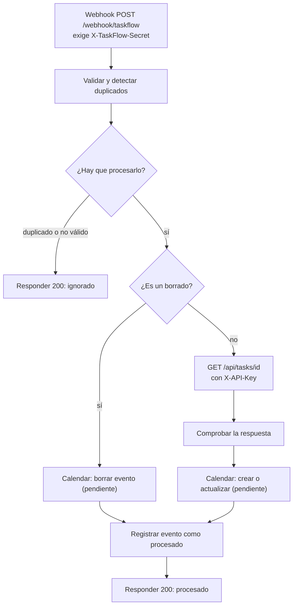

# Automatizaciones con n8n

La API de TaskFlow AI avisa a n8n cada vez que una tarea se crea, cambia, se completa o se elimina
(ver «Entrega de eventos» en el README principal). Esta carpeta guarda el **flujo de n8n** que recibe
esos avisos, para que viva en el repositorio y no solo dentro de una instalación concreta.

| Archivo | Qué es |
|---|---|
| [`workflows/taskflow-eventos.json`](workflows/taskflow-eventos.json) | El flujo: webhook protegido, descarte de duplicados y consulta de la tarea |
| [`../tools/check_n8n.py`](../tools/check_n8n.py) | Comprueba que el webhook está protegido y descarta duplicados |

## Qué hace el flujo



| Situación | Qué ocurre |
|---|---|
| Petición sin la cabecera secreta, o con una incorrecta | n8n responde **403**; el flujo no se ejecuta |
| Un `event_id` que ya se procesó | Responde 200 `ignorado` / `duplicado`, sin repetir nada |
| Evento de un tipo desconocido, o sin `event_id` / `task_id` válidos | Responde 200 `ignorado` (reintentarlo no lo arreglaría) |
| La API responde 404 al consultar la tarea | Normal: se borró mientras el evento esperaba. Sigue y responde 200 |
| La API no responde, rechaza la clave (401/403) o da 5xx | El evento **falla** y n8n responde error: la API lo **reintenta** con espera creciente. No se marca como procesado |

Un evento solo se marca como procesado **al terminar con éxito**. Si se marcara al empezar, uno que
falla a medias se perdería en el reintento.

> **Google Calendar todavía no está implementado.** Los nodos *Calendar* son marcadores que no hacen
> nada; ahí irán la creación, actualización y borrado de eventos.

## Instalación

### 1. Importar el flujo

En n8n: **Workflows → ⋯ → Import from file** y elige `workflows/taskflow-eventos.json`.

O por línea de comandos (con n8n **apagado**, porque escribe en su base de datos):

```bash
n8n import:workflow --input=n8n/workflows/taskflow-eventos.json
n8n publish:workflow --id=taskflowEventos01
```

Después reinicia n8n. El `id` del flujo es fijo: importarlo de nuevo **lo actualiza**, no lo duplica.

### 2. Crear las dos credenciales

El archivo del flujo no contiene ningún secreto: las referencia por nombre. En n8n, **Credentials →
Create credential → Header Auth**, dos veces:

| Nombre (exacto) | *Name* de la cabecera | *Value* |
|---|---|---|
| `TaskFlow - secreto del webhook` | `X-TaskFlow-Secret` | el valor de `N8N_WEBHOOK_SECRET` de la API |
| `TaskFlow - clave de la API` | `X-API-Key` | la clave que la API reconoce para `n8n` (ver abajo) |

Genera cada valor con `python -c "import secrets; print(secrets.token_urlsafe(32))"`. **Escríbelos
solo en n8n y en el `.env` de la API**, nunca en un chat, en un archivo del repositorio ni en el flujo.

Si tras importar algún nodo muestra «credencial no configurada», ábrelo y elige la credencial.

### 3. Ajustar la dirección de la API

En el nodo **Consultar la tarea en la API**, cambia `http://127.0.0.1:8000` por la dirección real de la
API. Usa `127.0.0.1` y no `localhost` en local: en n8n, `localhost` puede resolverse a IPv6 (`::1`) y
la API escucha en IPv4, así que la conexión falla.

### 4. Configurar la API

En el `.env` de la API (ver `.env.example`):

```text
N8N_WEBHOOK_URL=https://n8n.tu-empresa.com/webhook/taskflow
N8N_WEBHOOK_SECRET=el-mismo-valor-que-la-primera-credencial
API_KEYS=n8n:la-clave-de-la-segunda-credencial
```

La dirección debe ser la de **producción** (`/webhook/...`), no la de pruebas (`/webhook-test/...`, que
solo atiende una petición).

### 5. Desactivar el flujo del curso

Si tienes el flujo `TaskFlow AI - Primer Workflow` (webhook `nueva-tarea`), **desactívalo**: su webhook
no tiene ninguna autenticación y cualquiera puede enviarle datos.

### 6. Verificar

```bash
python tools/check_n8n.py https://n8n.tu-empresa.com/webhook/taskflow
```

Debe terminar con **«Todo correcto»**. La herramienta pide el secreto sin mostrarlo (o lo toma de
`N8N_WEBHOOK_SECRET`). Envía eventos de una tarea que no existe, así que no toca datos reales, pero
quedan registrados en el historial de ejecuciones de n8n.

## Límites conocidos

- **Los duplicados se recuerdan dentro de n8n** (datos estáticos del flujo: últimos 7 días y 5.000
  identificadores). Con varias instancias de n8n o en modo cola, esa memoria **no se comparte**; en
  ese caso haría falta un almacén común. Solo se guarda en ejecuciones de producción, no en las manuales.
- Dos entregas **simultáneas** del mismo evento podrían procesarse ambas (la API envía de uno en uno,
  así que solo ocurre si un envío tarda más de 5 s y se reintenta mientras el primero sigue corriendo).
- Mientras Calendar esté pendiente, el flujo solo valida, descarta duplicados y comprueba que la tarea
  se puede leer.

## Cambiar el flujo

Edítalo en n8n, expórtalo (**⋯ → Download**) y reemplaza `workflows/taskflow-eventos.json`. n8n no
exporta los valores de las credenciales, solo su nombre. Después, `pytest tools` comprueba que el flujo
sigue protegido, sin secretos y con respuesta en todos sus caminos.
